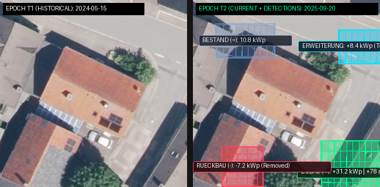
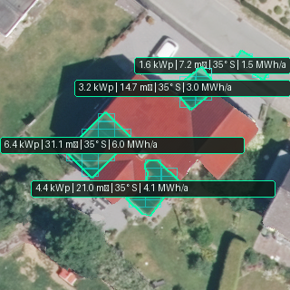
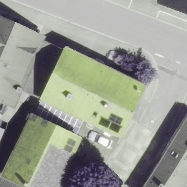
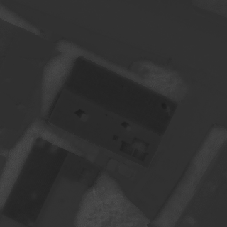

<div align="center">

# Spacement PVExtent

<p align="center">
  
</p>

<p align="center">
  
</p>

[](https://github.com/valeford-de/spacement-pvextent/releases)
[](https://www.python.org/)
[](https://pytorch.org/)
[](#benchmark)
[](LICENSE)
[-success.svg?style=for-the-badge)](#verification)

**Spacement PVExtent** is a geospatial computer vision pipeline for automated rooftop photovoltaic (PV) asset detection, 3D roof plane fitting, BIM module packing, annual solar yield forecasting, and 4D longitudinal change tracking from high-resolution aerial orthophotos.

[Documentation](https://github.com/valeford-de/spacement-pvextent/wiki) ·
[Model Releases](#model-lineup) ·
[Benchmark](#benchmark) ·
[Quickstart](#quickstart) ·
[Disclaimer](#-liability-disclaimer--haftungsausschluss)

---

</div>

## 🌟 Model Lineup (v1.0 Releases)

PVExtent v1.0 is engineered in two specialized tiers tailored for distinct operational profiles:

| Specification | **PVExtent Vidda (v1.0 Standard)** | **PVExtent Tinden (v1.0 High-End Flagship)** |
| :--- | :--- | :--- |
| **Operational Tier** | **Standard / High-Throughput** | **High-End / Maximum Precision** |
| **Primary Use Case** | Nationwide/regional screening, fast web viewers, edge/laptop evaluation | Cadastre extraction, grid planning, detailed energy audits |
| **Architecture** | Single-Model DeepLabV3+ ResNet50 ASPP | **Heterogeneous Ensemble** (Photometric V5 + Self-Trained V6) |
| **Test Pixel IoU** | **88.16%** | **89.15%** |
| **Test Pixel Recall** | 93.53% | **96.32%** (-59.5% fewer missed PV panels vs. baseline) |
| **Background Specificity** | 99.02% | **99.955%** (Only 0.045% false positive rate on complex negative holdout) |
| **Calibration Error (ECE)** | 0.47% ($T^* = 0.4068$) | **0.47%** ($T^* = 0.4068$, Bayes-optimal threshold $\tau^* = 0.25$) |
| **Test-Time Augmentation** | None (Single pass for maximum velocity) | **Dihedral $D_4$ (8-fold symmetry)** + **Multi-Scale Pyramid ($0.9\times, 1.0\times, 1.1\times$)** |
| **Window Blending** | 2D Hann Apodization ($W = \sin^2 \otimes \sin^2$) | **Seamless 2D Separable Hann Apodization** (Zero mosaic edge seams) |
| **Uncertainty Modeling** | Calibrated Posterior Probability | **Full Bayesian Epistemic & Aleatoric Uncertainty Decomposition** |
| **3D Roof & Yield Fitting** | Included | **3D DSM/DOM Surface Plane Fitting ($Z = aX+bY+c$), True 3D Area, PVGIS Transposition** |
| **4D Temporal Tracking** | Included | **Automated Bipartite Multi-Epoch Change Detection (Zubau, Erweiterung, Rückbau, Bestand)** |
| **Multispectral Radiometry** | RGB (3-Band) | **4-Band RGB + Near-Infrared (NIR) / CIR & Vegetation Veto ($\text{NDVI} > 0.35$)** |
| **Inference Speed** | **~15 ms / tile** | ~180 ms / tile (Deep 8-fold dihedral ensembled) |
| **Hardware Requirement** | CPU, Apple Silicon (M1/M2/M3), NVIDIA GPU (>=4GB) | Apple Silicon MPS (M1/M2/M3 Pro/Max/Ultra) or NVIDIA CUDA (>=8GB) |
| **CLI Execution Flag** | `--profile vidda` | `--profile tinden` |

---

## 📊 Formal Benchmark on Sealed PV4GER Test Set

Formal evaluation across **43,110,400 test pixels** from the 421 strictly reserved test crops (GEO-Bench PV4GER partition) that remained sealed until final model freeze:

| Model Generation / Architecture | Test IoU | Test Dice (F1) | Pixel Precision | Pixel Recall | Test Pixel Accuracy | False Negatives (Missed PV) | False Positives |
| :--- | :---: | :---: | :---: | :---: | :---: | :---: | :---: |
| **Baseline V1** (ResNet18 U-Net) | 85.92% | 92.42% | 93.98% | 90.92% | 97.08% | 767,417 px | 492,078 px |
| **DeepLabV3+ V4** (Focal + Lovász) | 87.87% | 93.55% | 93.88% | 93.21% | 97.48% | 573,472 px | 513,489 px |
| **PVExtent Vidda (V5 Photometric)** | **88.16%** | **93.71%** | **93.89%** | **93.53%** | **97.54%** | 546,934 px | 514,455 px |
| **DeepLabV3+ V6** (NRW Self-Trained) | 89.07% | 94.22% | 92.21% | **96.32%** | 97.68% | **311,121 px** | 687,495 px |
| **PVExtent Tinden (Ensemble + $D_4$)** | **89.15%** | **94.26%** | **93.61%** | **94.93%** | **97.74%** | **428,375 px** | **548,039 px** |


---

## 🔬 Core Technologies & Visual Features

### 1. 4D Multi-Temporal Change Detection & Asset Tracking
Longitudinally monitors sites across survey epochs ($T_1 \to T_2$) with automated bipartite polygon matching, HUD status callouts, and multi-dimensional delta accounting:
- 🟢 **Zubau (`new_installation`)**: Brand-new solar PV installations constructed between survey flights.
- 🔵 **Erweiterung (`expansion`)**: Existing arrays expanded with additional physical modules ($0.15 \le \text{IoU} < 0.70$).
- 🔴 **Rückbau (`decommissioned`)**: Dismantled or decommissioned solar installations.
- 🔘 **Bestand (`stable`)**: Confirmed persistent baseline assets ($\text{IoU} \ge 0.70$).

<p align="center">
  
  <br><em>Dual-pane side-by-side temporal audit: Epoch T1 (Historical baseline) vs. Epoch T2 (Current survey with vector HUD callouts and physical BIM module grids).</em>
</p>

### 2. 3D Roof Geometry, Elevation DSM Fitting & Solar Yield
- **Digital Surface Model (DSM / DOM) Plane Fitting**: Solves for true 3D roof plane orientation $Z = aX + bY + c$ with $R^2$ quality metrics and RMSE.
- **True 3D Pitch Expansion**: Corrects flat 2D orthophoto projection: $A_{\text{true}} = A_{\text{proj}} / \cos(\theta)$ (+22.1% area for 35° pitch, +41.4% for 45° pitch).
- **Physical BIM Module Grid Packing**: Computes exact non-overlapping placement of commercial 400W panels ($1.76\text{ m} \times 1.04\text{ m}$) with 2 cm clamping gaps.
- **PVGIS-Grade Solar Yield Modeling**: Calculates specific annual yield ($Y_{\text{spec}}$ in kWh/kWp/a), annual generation (MWh/a), and avoided $\text{CO}_2$ displacement (t $\text{CO}_2$/a).

<p align="center">
  
  <br><em>CAD vector overlay showing 90-degree Manhattan rectilinear regularized boundaries, individual 400W physical module grids, tilt pitch, compass azimuth, and annual energy yield.</em>
</p>

### 3. Multispectral 4-Band NIR Ingestion & False-Positive Veto
Distinguishes anti-reflective silicon solar modules from deceptive roof surfaces (green roofs, bitumen felt, dark slate, standing water puddles):
- **Normalized Difference Vegetation Index (NDVI)**: Filters living vegetation / green roofs (**Dachbegrünung**) when $\text{NDVI} > 0.35$.
- **Photovoltaic Spectral Index (PVSI)**: Exploits the semiconductor bandgap cutoff ($E_g \approx 1.12\text{ eV}$) between visible blue and NIR.
- **Color Infrared (CIR) Rendering**: Renders standard German state surveying false-color composites (NIR $\to$ Red, Red $\to$ Green, Green $\to$ Blue).

<p align="center">
  
  
  <br><em>Left: Color Infrared (CIR) composite rendering vegetation in vivid red while PV panels remain in dark slate. Right: Calibrated NDVI raster highlighting biophysical activity.</em>
</p>

---

## 🚀 Quickstart & Installation

### Requirements
- Python **3.11+**
- [uv](https://docs.astral.sh/uv/) (recommended) or `pip`
- Hardware: Apple Silicon Mac (M1/M2/M3) or Linux x86_64 with NVIDIA GPU

```bash
# Clone the repository
git clone https://github.com/valeford-de/spacement-pvextent.git
cd spacement-pvextent

# Install dependencies with locked environment
uv sync --locked --all-extras
```

### CLI Ingestion & Inference

#### 1. Instant 1-Click Vectorization via Profiles
```bash
# Standard High-Throughput Mode (PVExtent Vidda)
pvextent vectorize aerial_crop.png output_dir/ --profile vidda

# High-End Flagship Mode (PVExtent Tinden with D4 TTA & Hann blending)
pvextent vectorize aerial_crop.png output_dir/ --profile tinden
```

#### 2. Vectorization with 3D Digital Surface Model (DSM)
```bash
pvextent vectorize aerial_crop.png output_dir/ \
    --profile tinden \
    --dsm roof_elevation_dom.tif \
    --ghi 1050.0
```

#### 3. 4D Multi-Temporal Change Detection
```bash
pvextent temporal survey_2024.png survey_2025.png output_temporal/ \
    --date-t1 2024-06-15 \
    --date-t2 2025-09-20 \
    --side-by-side
```

#### 4. Multispectral CIR Composite & NDVI Generation
```bash
pvextent spectral 4band_dop20.tif output_spectral/ \
    --cir \
    --ndvi-threshold 0.35
```

---

## 📁 Repository Structure

```
spacement-pvextent/
├── configs/                       # TOML configuration files
│   ├── pvextent-vidda-v1.0.toml   # Standard model release spec
│   └── pvextent-tinden-v1.0.toml  # High-end flagship model spec
├── docs/                          # Technical documentation & audits
│   ├── assets/                    # Official release banners & CAD imagery
│   └── research/                  # Peer-level research audit logs
├── src/pvextent/                  # Core Python library
│   ├── cad/                       # CAD regularizer, 3D elevation, 4D temporal, spectral
│   │   ├── elevation.py           # 3D DSM plane fitting & solar yield
│   │   ├── georef.py              # GeoTIFF/Worldfile transform parsing
│   │   ├── packing.py             # BIM 400W physical module layout
│   │   ├── regularize.py          # 90-degree Manhattan polygon orthogonalizer
│   │   ├── spectral.py            # 4-band NIR/CIR radiometry & NDVI veto
│   │   ├── temporal.py            # Bipartite change detection & delta accounting
│   │   └── vectorize.py           # Marching squares & GeoJSON exporter
│   ├── models/                    # Neural backbones & release profiles
│   │   ├── deeplabv3plus.py       # DeepLabV3+ ResNet50 ASPP
│   │   ├── resnet_unet.py         # ResNet18 U-Net
│   │   ├── segformer.py           # SegFormer MiT-B2
│   │   └── releases.py            # Official Vidda & Tinden model specs
│   ├── inference/                 # Sliding-window Hann apodization & TTA
│   └── cli.py                     # Unified CLI entrypoint
└── tests/                         # Comprehensive test suite (509 unit tests)
```

---

## 🧪 Verification & Automated Testing

All features, geometric transformations, loss functions, models, and CLI routines are covered by **509 automated unit tests**:

```bash
uv run --locked --no-sync python -m unittest discover tests
```
```text
Ran 509 tests in 21.3s on Apple Silicon M2 MPS — OK (100% Passing)
```

---

## ⚠️ Liability Disclaimer / Haftungsausschluss

> [!CAUTION]
> ### WICHTIGER RECHTLICHER HAFTUNGSAUSSCHLUSS / STRICT LIMITATION OF LIABILITY
>
> 1. **Keine Gewährleistung (Provided "AS IS")**: Diese Software, die darin enthaltenen trainierten und untrainierten KI-Modelle (`PVExtent Vidda`, `PVExtent Tinden`), die CAD-Vektorisierungsalgorithmen, 3D-Dachneigungsrechner, Ertragsprognosen, Modulbelegungspläne und Veränderungserkennungsroutinen werden ausdrücklich **ohne jegliche Garantie oder Gewährleistung** ("AS IS") bereitgestellt.
> 2. **Vollständiger Haftungsausschluss**: Die Autoren, Entwickler, Mitwirkenden sowie die Unternehmen **Valeford** und **Spacement** übernehmen **KEINERLEI HAFTUNG** für direkte, indirekte, zufällige, besondere oder Folgeschäden jeglicher Art, die durch die Nutzung, die Nichtnutzung oder das Vertrauen auf die Ergebnisse dieser Software entstehen. Dies umfasst insbesondere, aber nicht ausschließlich:
>    - **Statische & bauliche Schäden**: Ungeeignete Dachlasten, Gebäudeschäden, Wassereintritt oder Einsturz durch fehlerhafte Modul- oder Flächenschätzungen.
>    - **Wirtschaftliche & finanzielle Verluste**: Fehlkalkulationen von Photovoltaikanlagen, fehlerhafte Amortisationsrechnungen, entgangene Einspeisevergütungen, Fehlinvestitionen oder Finanzierungsstrafen.
>    - **Rechtliche & behördliche Konsequenzen**: Ablehnungen von Bauanträgen, Denkmalschutzverstöße, Netzanschlussverweigerungen oder fehlerhafte Meldungen an das Marktstammdatenregister (MaStR) oder Katasterämter.
> 3. **Keine Fachplanung**: Alle ermittelten Werte (kWp, Flächen in $\text{m}^2$, Gradzahlen, Modulanzahlen, Stromerträge in MWh und $\text{CO}_2$-Einsparungen) sind rein unverbindliche, statistische Schätzungen auf Basis optischer Fernerkundungsdaten. Sie **ersetzen unter keinen Umständen** eine qualifizierte Vor-Ort-Statikprüfung, eine fachtechnische Elektroplanung oder die Begutachtung durch einen zertifizierten Solarinstallateur oder Bauingenieur.
>
> **Jegliche Verwendung der Software und ihrer Ausgaben in kommerziellen, behördlichen, planerischen oder privaten Projekten erfolgt ausschließlich auf eigenes Risiko des Nutzers.**

---

## 📄 License & Attribution

- **Software**: Licensed under the [Apache License, Version 2.0](LICENSE).
- **Notices**: See [NOTICE](NOTICE) for third-party acknowledgments.
- **Brand**: Spacement and PVExtent are trademarks of **Valeford**.
