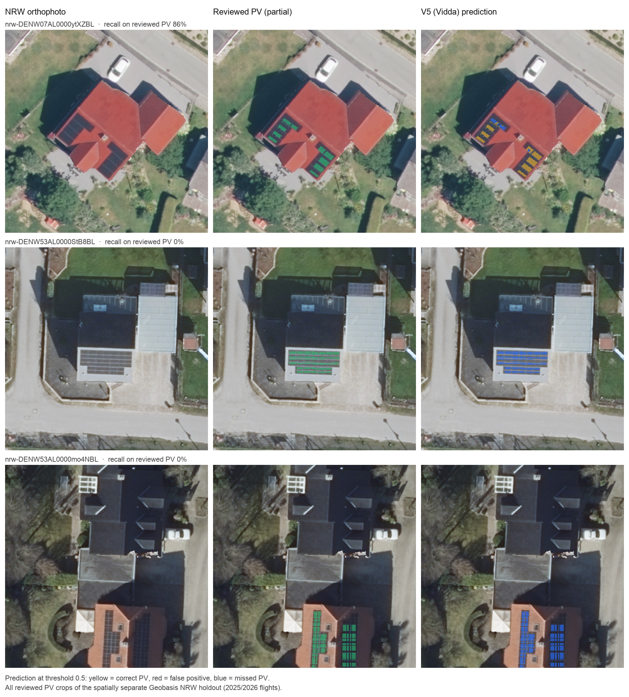
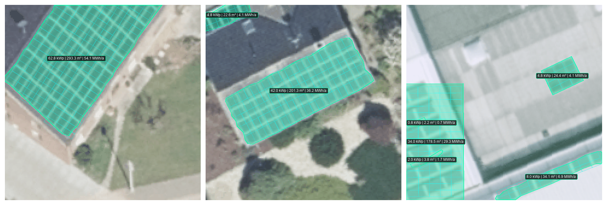
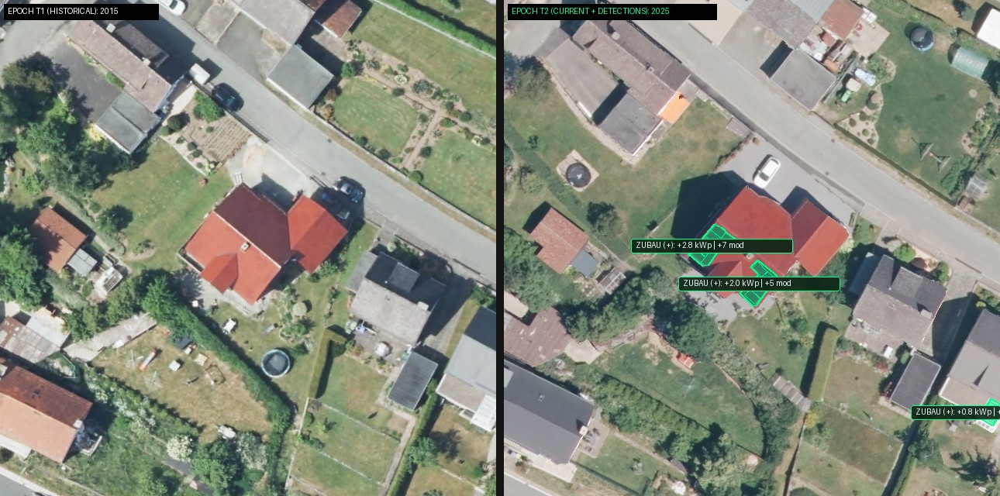
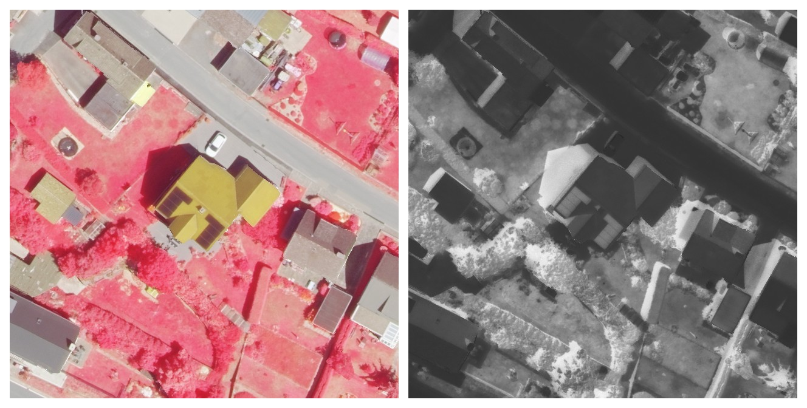

<div align="center">

# Spacement PVExtent

<p align="center">
  
  &nbsp;
  
</p>

[](https://github.com/valeford-de/spacement-pvextent/releases)
[](https://www.python.org/)
[](https://pytorch.org/)
[](LICENSE)
[](#testing)

Rooftop photovoltaic (PV) segmentation and vectorization from aerial orthophotos,
with module layout, roof-plane fitting, yield estimates and multi-epoch change
detection. A standalone research project by **Valeford**, under the **Spacement** brand.

[Documentation](https://github.com/valeford-de/spacement-pvextent/wiki) ·
[Model lineup](#model-lineup) ·
[Benchmark](#benchmark) ·
[Quickstart](#quickstart) ·
[Disclaimer](#disclaimer)

</div>

## Preview


Real V5 (Vidda) predictions on sealed PV4GER test crops, picked at the 90th, 50th and
10th percentile of per-crop IoU (97.4%, 91.3%, 64.6%) rather than by hand. Typical
errors are filled gaps between module rows and skylights mistaken for PV. All figures
are regenerated by [`examples/render_readme_figures.py`](examples/render_readme_figures.py);
see [figure provenance](docs/assets/README.md).

### Current NRW imagery

The PV4GER benchmark does not transfer to current Geobasis NRW orthophotos. NRW test
set v1 is a random sample of 321 roofs from ten districts, labelled blind by a human
annotator ([protocol](docs/research/nrw-test-v1-protocol.md)); 42 crops contain PV.
Each model was evaluated once, with 95% bootstrap intervals over crops:

| Model | IoU | Precision | PV roofs found | False alarms on PV-free roofs |
| :--- | :---: | :---: | :---: | :---: |
| **Fjell** (V7) | **54.1%** [42–63] | **74.8%** | 27 / 42 | **6.5%** [4–9] |
| Tinden | 53.3% [43–62] | 65.9% | 34 / 42 | 16.5% [12–21] |
| Vidda (V5) | 44.1% [33–53] | 49.2% | **35 / 42** | 33.7% [28–39] |

Fjell trades recall for precision: it raises the fewest false alarms (glass roofs,
skylights, conservatories, dark roofing) but misses about a third of PV roofs, because
its automatically built NRW labels leave part of the real PV area as background
([results and label audit](docs/research/nrw-train-v1-results.md)). Use Tinden or Vidda
when missing an array costs more than a false alarm.



Vidda (V5) on the three PV crops of the earlier, spatially separate NRW holdout: it
finds 86% of the PV pixels on one building and none on the other two.

## Model lineup

| | **PVExtent Fjell** | **PVExtent Vidda** | **PVExtent Tinden** |
| :--- | :--- | :--- | :--- |
| **Profile** | Current NRW imagery, fewest false alarms | Standard, high throughput | High-end, ensemble |
| **Architecture** | DeepLabV3+ ResNet50 ASPP (V7: Vidda recipe plus reviewed NRW hard negatives) | DeepLabV3+ ResNet50 ASPP (V5, photometric augmentation) | Equal-weight ensemble of V5 and V6 (V6: self-trained on NRW pseudo-labels) |
| **Test-time augmentation** | None | None | Dihedral $D_4$ (8 orientations) |
| **Tiling** | 400 px tiles, 50% overlap, 2D Hann blending | 400 px tiles, 25% overlap, 2D Hann blending | 400 px tiles, 50% overlap, 2D Hann blending |
| **Calibration / threshold** | None, 0.5 | None, 0.5 | Temperature scaling, $T = 0.4068$; 0.505 |
| **Sealed test IoU** | 88.83% | 88.16% | 89.15% |
| **Sealed test recall** | 93.71% | 93.53% | 94.93% |
| **NRW test v1 IoU** | 54.1% | 44.1% | 53.3% |
| **CLI** | `--profile fjell` | `--profile vidda` | `--profile tinden` |

Sealed test metrics come from the [sealed benchmark](#benchmark), which covers PV4GER
imagery only; NRW figures from [NRW test set v1](#current-nrw-imagery). Each CLI profile
runs exactly the configuration that was measured. Multi-scale TTA (`--scales`) and the
vegetation veto remain available as options but have not been evaluated. Checkpoints are not distributed with this
repository.

## Benchmark

Evaluated once on the 421 reserved PV4GER test crops (43,110,400 pixels) after model
freeze. Bold marks the best value per column. Details:
[sealed benchmark audit](docs/research/sealed-421-test-benchmark.md).

| Model | IoU | Dice | Precision | Recall | Pixel accuracy |
| :--- | :---: | :---: | :---: | :---: | :---: |
| Baseline V1 (ResNet18 U-Net) | 85.92% | 92.42% | 93.98% | 90.92% | 97.08% |
| DeepLabV3+ V4 (Focal + Lovász) | 87.87% | 93.55% | 93.88% | 93.21% | 97.48% |
| DeepLabV3+ V5 — **Vidda** | 88.16% | 93.71% | 93.89% | 93.53% | 97.54% |
| DeepLabV3+ V5 + $D_4$ TTA, calibrated | 87.95% | 93.59% | 94.06% | 93.12% | 97.50% |
| DeepLabV3+ V6 + $D_4$ TTA, calibrated | 89.07% | 94.22% | 92.21% | **96.32%** | 97.68% |
| Ensemble V5 + V6 + $D_4$ — **Tinden** | **89.15%** | **94.26%** | 93.61% | 94.93% | **97.74%** |
| DeepLabV3+ V7 — **Fjell** | 88.83% | 94.08% | **94.46%** | 93.71% | 97.69% |

The V1, V4, V5 (Vidda), V6 and Tinden rows were re-run on 2026-10-22 and reproduce the
recorded values exactly; V7 was evaluated once after training on the same day.

## Features

- **Vectorization**: marching-squares polygons, optional 90° rectilinear
  regularization, GeoJSON export with GeoTIFF/world-file georeferencing.
- **Module layout**: non-overlapping placement of 1.76 m × 1.04 m, 400 W modules with
  2 cm gaps, giving module counts and kWp estimates.
- **Roof geometry and yield**: plane fitting $Z = aX + bY + c$ on a DSM to derive tilt,
  azimuth and true surface area $A_{\text{proj}} / \cos\theta$; annual yield and CO₂
  estimates from irradiation and a fixed performance ratio.
- **Change detection**: polygon matching between two survey epochs, classifying arrays
  as new, expanded, decommissioned or stable.
- **Multispectral input**: NDVI, PV spectral index and color-infrared composites from
  4-band RGB+NIR imagery, plus an optional vegetation veto.

Roof geometry requires a DSM; without one, tilt and azimuth are manual inputs.
Spectral features require a real NIR band; with RGB-only input the CLI substitutes a
pseudo-NIR channel, and the resulting NDVI/CIR output is not physically meaningful.



`pvextent vectorize --profile vidda` on the same three test crops: regularized polygons,
fitted 400 W module grid and kWp/yield estimates. Without a DSM the roof is treated as
flat. In the right crop the separate module rows on the left still merge into one
block, and the skylight on the right is counted as a 4.8 kWp array, which is wrong.



`pvextent temporal` with the V5 checkpoint on a 64 m Geobasis NRW window, 2015 vs. 2025.
Both arrays added to the red roof are found; the third detection at the right edge is a
glass conservatory roof, a false positive.



`pvextent spectral` on the 2025 image with the real NRW near-infrared layer: CIR
composite (vegetation red, PV dark) and NDVI (bright = vegetation). Computed from 8-bit
WMS display layers, so values are relative rather than calibrated reflectance.

## Quickstart

Requires Python **3.11+** and [uv](https://docs.astral.sh/uv/). Apple Silicon (MPS),
NVIDIA CUDA and CPU are supported.

```bash
git clone https://github.com/valeford-de/spacement-pvextent.git
cd spacement-pvextent
uv sync --locked --all-extras
```

Vectorize an orthophoto with a release profile (checkpoints are expected under `runs/`):

```bash
pvextent vectorize aerial_crop.png output_dir/ --profile fjell
pvextent vectorize aerial_crop.png output_dir/ --profile vidda
pvextent vectorize aerial_crop.png output_dir/ --profile tinden
```

Add a surface model for roof tilt, azimuth and yield:

```bash
pvextent vectorize aerial_crop.png output_dir/ --profile tinden \
    --dsm roof_dsm.tif --ghi 1050.0
```

Compare two survey epochs:

```bash
pvextent temporal survey_2024.png survey_2025.png output_temporal/ \
    --date-t1 2024-06-15 --date-t2 2025-09-20
```

Spectral analysis of a 4-band RGB+NIR image:

```bash
pvextent spectral dop20_rgbi.tif output_spectral/ --ndvi-threshold 0.35
```

## Repository structure

```
configs/             Model release and training configurations
docs/                Documentation, research audits and README assets
scripts/             Benchmark and demo scripts
src/pvextent/
  cad/               Vectorization, regularization, packing, elevation, temporal, spectral
  data/              Dataset import, curation and splits
  evaluation/        Metrics and holdout evaluation
  inference/         Tiled inference, TTA and calibration
  models/            U-Net, DeepLabV3+, SegFormer and release profiles
  training/          Training loops and losses
  cli.py             Command-line entry point
tests/               Unit tests
```

## Testing

```bash
uv run --locked --no-sync python -m unittest discover tests
```

## Disclaimer

This software and its models are provided "as is", without warranty of any kind, under
the Apache License 2.0. All outputs, including areas, module counts, kWp, yield and CO₂
figures, are statistical estimates from aerial imagery. They do not replace on-site
structural, electrical or permitting assessments. Use at your own risk.

## License

Licensed under the [Apache License, Version 2.0](LICENSE). See [NOTICE](NOTICE) for
third-party acknowledgments. Spacement and PVExtent are trademarks of **Valeford**.

<p align="center">
  
</p>
