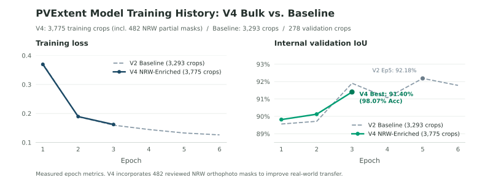

Photovoltaic array segmentation from orthophotos. A standalone research project
by **Valeford**, under the **Spacement** brand.

PVExtent prepares georeferenced datasets, trains segmentation models and exports
predictions for review. The current baseline is a U-Net with an ImageNet-pretrained
ResNet18 encoder. It is experimental; trained PVExtent weights have not been released.

[Documentation](https://github.com/valeford-de/spacement-pvextent/wiki) ·
[Research roadmap](docs/roadmap.md) ·
[Issues](https://github.com/valeford-de/spacement-pvextent/issues)

## Preview


Native 320 × 320 NRW crops at 10 cm/pixel. The middle column shows experimental
AI-reviewed **partial labels**; unmarked pixels are unknown. The right column
shows actual model output at threshold 0.5, including its mistakes. These two
examples illustrate the workflow and do not measure accuracy.
[Image sources and checkpoint](docs/assets/README.md).

## Results

| Evaluation | Scope | Result |
| --- | --- | --- |
| Internal validation | Best checkpoint from six total epochs; 278 crops | **92.18% IoU · 95.93% Dice** |
| Exploratory NRW positive pilot | Earlier three-epoch candidate; 3 partially labelled crops | **4.05% recall** on confirmed PV pixels |

The six-epoch checkpoint has not been evaluated on the NRW pilot. The pilot
exposes poor transfer for the earlier model; internal validation scores do not
establish reliable detection on new imagery. See the
[training report](docs/research/training-extension-audit.md) and
[NRW pilot report](docs/research/positive-holdout-audit.md).



A further **482 AI-reviewed partial masks** are prepared for a separate training
experiment. The current model has not trained on them.
[Dataset preparation report](docs/research/nrw-bulk-mask-curation-audit.md).

## Development setup

Requires Python **3.11+** and [uv](https://docs.astral.sh/uv/getting-started/installation/).
Install from source:

```sh
git clone https://github.com/valeford-de/spacement-pvextent.git
cd spacement-pvextent
uv sync --locked
uv run --locked --no-sync pvextent --help
```

Try the dataset format with a small synthetic example:

```sh
uv run --locked --no-sync python examples/create_demo_dataset.py data/demo
uv run --locked --no-sync pvextent data validate data/demo --json
```

The demo checks the file format; it is not training data. For real imagery,
start with the [PV4GER-SEG import guide](docs/pv4ger-import.md), then follow
[baseline training](docs/baseline-training.md) to install the training dependencies
and prepare encoder weights.

## Workflows

| Task | Guide |
| --- | --- |
| Prepare imagery and masks | [Dataset format](docs/data-format.md), [annotation rules](docs/annotation-guide.md), [geographic splits](docs/geographic-splits.md) |
| Review labels | [Local gallery](docs/label-review.md), [two-check partial-mask curation](docs/bulk-mask-curation.md) |
| Train and resume | [Pretrained baseline](docs/baseline-training.md), [encoder provenance](docs/pretrained-weights.md) |
| Inspect model output | [Candidate predictions](docs/candidate-predictions.md), [validation errors](docs/validation-errors.md) |
| Follow training live | [Local training monitor](docs/live-training.md) |

The [wiki](https://github.com/valeford-de/spacement-pvextent/wiki) indexes the
full documentation. Experiment history, evaluation limits and next steps live
in the [research roadmap](docs/roadmap.md); versioned files in `docs/` are the
canonical source.

## Contributing

Use [GitHub Issues](https://github.com/valeford-de/spacement-pvextent/issues) for
bugs and research proposals. Include the command, configuration and relevant
logs when reporting a failure. Keep datasets and checkpoints outside Git.

Run the full test suite with all optional dependencies installed:

```sh
uv sync --locked --all-extras
uv run --locked --no-sync python -m unittest discover -s tests -v
```

Report vulnerabilities privately through the [security policy](.github/SECURITY.md).

## License and attribution

Project code and new Valeford annotations use [Apache-2.0](LICENSE).
Preserve the applicable copyright and [NOTICE](NOTICE) information.

Imagery, upstream annotations and encoder weights retain their own licenses:
[PV4GER-SEG](docs/pv4ger-import.md#source-versions-and-licenses),
[encoder weights](docs/pretrained-weights.md),
[README imagery and graphics](docs/assets/README.md).

<a href="https://valeford.de">
  
</a>
