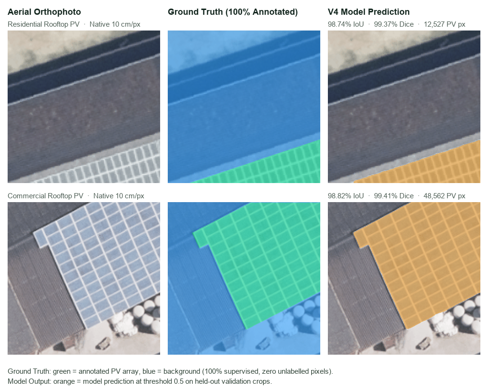

<div align="center">

# Spacement PVExtent

<p align="center">
  
  &nbsp;
  
</p>

[](https://github.com/valeford-de/spacement-pvextent/releases)
[](https://www.python.org/)
[](https://pytorch.org/)
[](LICENSE)
[](#testing)

Rooftop photovoltaic (PV) segmentation and vectorization from aerial orthophotos,
with module layout, roof-plane fitting, yield estimates and multi-epoch change
detection. A standalone research project by **Valeford**, under the **Spacement** brand.

[Documentation](https://github.com/valeford-de/spacement-pvextent/wiki) ·
[Model lineup](#model-lineup) ·
[Benchmark](#benchmark) ·
[Quickstart](#quickstart) ·
[Disclaimer](#disclaimer)

</div>

## Preview



Native 320 × 320 crops at 10 cm/pixel from the geographically held-out validation
partition, with complete ground truth and predictions from the V4 checkpoint at
threshold 0.5. These are two illustrative samples, not a summary metric; see
[sample provenance](docs/assets/README.md).

## Model lineup

| | **PVExtent Vidda** | **PVExtent Tinden** |
| :--- | :--- | :--- |
| **Profile** | Standard, high throughput | High-end, maximum accuracy |
| **Architecture** | DeepLabV3+ ResNet50 ASPP (V5, photometric augmentation) | Equal-weight ensemble of V5 and V6 (V6: self-trained on NRW pseudo-labels) |
| **Test-time augmentation** | None | Dihedral $D_4$ (8 orientations) + scales 0.9 / 1.0 / 1.1 |
| **Tiling** | 400 px tiles, 25% overlap, 2D Hann blending | 400 px tiles, 50% overlap, 2D Hann blending |
| **Calibration** | None | Temperature scaling, $T = 0.4068$ |
| **Sealed test IoU** | 88.16% | 89.15% |
| **Sealed test recall** | 93.53% | 94.93% |
| **CLI** | `--profile vidda` | `--profile tinden` |

Test metrics come from the [sealed benchmark](#benchmark). The benchmarked Tinden
configuration used $D_4$ TTA at a single scale; the multi-scale averaging of the CLI
profile was not part of that evaluation. Checkpoints are not distributed with this
repository.

## Benchmark

Evaluated once on the 421 reserved PV4GER test crops (43,110,400 pixels) after model
freeze. Bold marks the best value per column. Details:
[sealed benchmark audit](docs/research/sealed-421-test-benchmark.md).

| Model | IoU | Dice | Precision | Recall | Pixel accuracy |
| :--- | :---: | :---: | :---: | :---: | :---: |
| Baseline V1 (ResNet18 U-Net) | 85.92% | 92.42% | **93.98%** | 90.92% | 97.08% |
| DeepLabV3+ V4 (Focal + Lovász) | 87.87% | 93.55% | 93.88% | 93.21% | 97.48% |
| DeepLabV3+ V5 — **Vidda** | 88.16% | 93.71% | 93.89% | 93.53% | 97.54% |
| DeepLabV3+ V5 + $D_4$ TTA, calibrated | 87.95% | 93.59% | 94.06% | 93.12% | 97.50% |
| DeepLabV3+ V6 + $D_4$ TTA, calibrated | 89.07% | 94.22% | 92.21% | **96.32%** | 97.68% |
| Ensemble V5 + V6 + $D_4$ — **Tinden** | **89.15%** | **94.26%** | 93.61% | 94.93% | **97.74%** |

V6 misses 59.5% fewer PV pixels than the V1 baseline (311,121 vs. 767,417). On a
separate 7-crop negative holdout of difficult roofs (716,800 pixels), V6 at
threshold 0.5 produced 325 false-positive pixels (0.045%).

## Features

- **Vectorization**: marching-squares polygons, optional 90° rectilinear
  regularization, GeoJSON export with GeoTIFF/world-file georeferencing.
- **Module layout**: non-overlapping placement of 1.76 m × 1.04 m, 400 W modules with
  2 cm gaps, giving module counts and kWp estimates.
- **Roof geometry and yield**: plane fitting $Z = aX + bY + c$ on a DSM to derive tilt,
  azimuth and true surface area $A_{\text{proj}} / \cos\theta$; annual yield and CO₂
  estimates from irradiation and a fixed performance ratio.
- **Change detection**: polygon matching between two survey epochs, classifying arrays
  as new, expanded, decommissioned or stable.
- **Multispectral input**: NDVI, PV spectral index and color-infrared composites from
  4-band RGB+NIR imagery, plus an optional vegetation veto.

Roof geometry requires a DSM; without one, tilt and azimuth are manual inputs.
Spectral features require a real NIR band; with RGB-only input the CLI substitutes a
pseudo-NIR channel, and the resulting NDVI/CIR output is not physically meaningful.

## Quickstart

Requires Python **3.11+** and [uv](https://docs.astral.sh/uv/). Apple Silicon (MPS),
NVIDIA CUDA and CPU are supported.

```bash
git clone https://github.com/valeford-de/spacement-pvextent.git
cd spacement-pvextent
uv sync --locked --all-extras
```

Vectorize an orthophoto with either profile (checkpoints are expected under `runs/`):

```bash
pvextent vectorize aerial_crop.png output_dir/ --profile vidda
pvextent vectorize aerial_crop.png output_dir/ --profile tinden
```

Add a surface model for roof tilt, azimuth and yield:

```bash
pvextent vectorize aerial_crop.png output_dir/ --profile tinden \
    --dsm roof_dsm.tif --ghi 1050.0
```

Compare two survey epochs:

```bash
pvextent temporal survey_2024.png survey_2025.png output_temporal/ \
    --date-t1 2024-06-15 --date-t2 2025-09-20
```

Spectral analysis of a 4-band RGB+NIR image:

```bash
pvextent spectral dop20_rgbi.tif output_spectral/ --ndvi-threshold 0.35
```

## Repository structure

```
configs/             Model release and training configurations
docs/                Documentation, research audits and README assets
scripts/             Benchmark and demo scripts
src/pvextent/
  cad/               Vectorization, regularization, packing, elevation, temporal, spectral
  data/              Dataset import, curation and splits
  evaluation/        Metrics and holdout evaluation
  inference/         Tiled inference, TTA and calibration
  models/            U-Net, DeepLabV3+, SegFormer and release profiles
  training/          Training loops and losses
  cli.py             Command-line entry point
tests/               Unit tests
```

## Testing

```bash
uv run --locked --no-sync python -m unittest discover tests
```

## Disclaimer

This software and its models are provided "as is", without warranty of any kind, under
the Apache License 2.0. All outputs, including areas, module counts, kWp, yield and CO₂
figures, are statistical estimates from aerial imagery. They do not replace on-site
structural, electrical or permitting assessments. Use at your own risk.

## License

Licensed under the [Apache License, Version 2.0](LICENSE). See [NOTICE](NOTICE) for
third-party acknowledgments. Spacement and PVExtent are trademarks of **Valeford**.

<p align="center">
  
</p>
